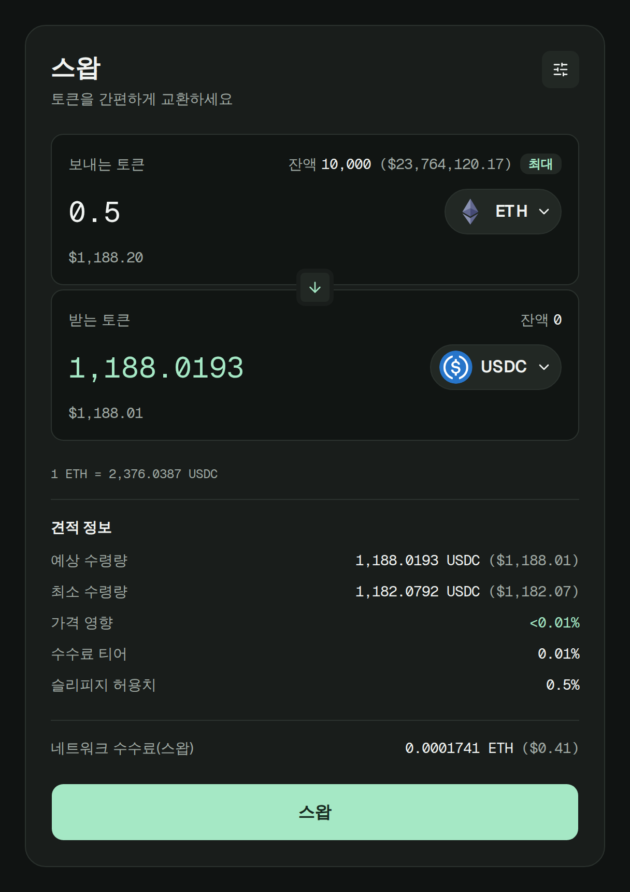

# GOPEPE Swap

**Ethereum, Base, Arbitrum을 위한 Uniswap V3 스왑**

**[앱 열기 →](https://gopepe-swap.vercel.app)**



> [!WARNING]
> 메인넷에서 실제 자산으로 동작합니다. 이 앱은 보안 감사를 받지 않았습니다. 토큰 승인은 무제한(`maxUint256`)으로 요청합니다.

## 기능

- 수수료 티어 4개(0.01%, 0.05%, 0.3%, 1%)를 모두 견적해 보고 가장 많이 받는 풀로 스왑합니다.
- 금액과 잔액 옆에 달러 가치를 같이 보여 줍니다. 가격은 Uniswap 견적으로 구합니다.
- 다음 트랜잭션의 수수료를 미리 보여 주고, 보내는 금액의 5% 이상이거나 ETH가 모자라면 알려 줍니다.
- 배치(EIP-5792)를 지원하는 지갑이면 승인과 스왑을 한 번에 확인합니다.

## 사용 방법

1. 헤더에서 네트워크를 고르고 브라우저 지갑을 연결합니다.
2. 보낼 토큰과 받을 토큰을 고르고 금액을 입력합니다.
3. 예상 수령량, 달러 가치, 네트워크 수수료를 확인합니다.
4. 버튼을 눌러 승인과 스왑을 보냅니다. 네트워크가 다르면 지갑을 선택한 체인으로 먼저 전환합니다.

## 지원 범위

| 항목     | 지원                                                                        |
| -------- | --------------------------------------------------------------------------- |
| 네트워크 | Ethereum, Base, Arbitrum 메인넷                                             |
| 지갑     | EIP-6963을 지원하는 브라우저 확장 지갑 (MetaMask 등)                        |
| 토큰     | 체인별 기본 토큰 목록 (Ethereum 약 480개, Arbitrum 약 230개, Base 약 200개) |
| 스왑     | Uniswap V3 단일 홉, 보내는 금액 지정(exactInput), ETH ↔ WETH 전환           |

## 기술 스택

- Next.js 16 (App Router), React 19, TypeScript
- wagmi 3, viem
- Tailwind CSS 4, shadcn/ui, Base UI
- Uniswap V3 QuoterV2, SwapRouter02
- Vercel

## 로컬 실행

Node 24.21.0(`.nvmrc`)과 bun 1.4.2가 필요합니다.

```bash
cp .env.example .env.local
bun install
bun run dev
```

http://localhost:3000 에서 열립니다.

`.env.local`에는 체인별 RPC URL을 넣습니다. 서버의 RPC 프록시만 읽는 값이라 브라우저에 노출되지 않습니다. 비워 두면 공개 RPC로 동작합니다.

| 변수                   | 체인     |
| ---------------------- | -------- |
| `ETH_MAINNET_RPC_URL`  | Ethereum |
| `BASE_MAINNET_RPC_URL` | Base     |
| `ARB_MAINNET_RPC_URL`  | Arbitrum |

## 테스트

```bash
bun run test       # 단위 및 통합 테스트
bun run test:fork  # anvil Ethereum 포크 통합 테스트
bun run test:e2e   # Playwright E2E
```

`test:fork`와 `test:e2e`는 Foundry `anvil`과 `ETH_MAINNET_RPC_URL`이 필요합니다. Playwright를 처음 실행하기 전에 `bunx playwright install chromium`을 실행합니다.
